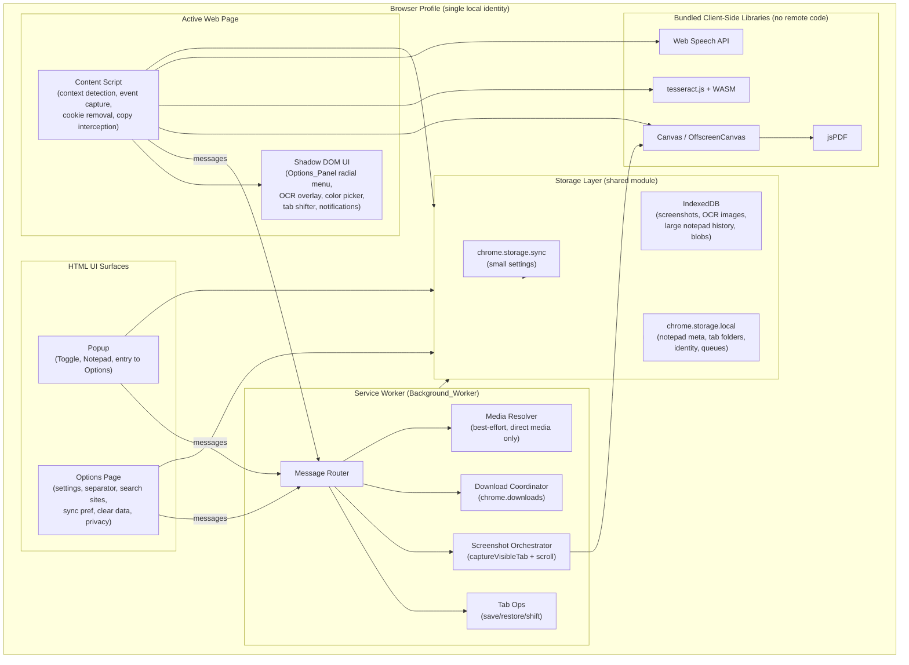

# Design Document

## Overview

Alpha Cursor is a **100% client-side** Chrome Manifest V3 (MV3) extension that surfaces a productivity toolkit through a radial, context-aware options panel triggered by a middle-mouse click. This design reflects a hard constraint from the product owner that **overrides parts of the requirements**: there is **no server, no backend, and no `alphacursor.com` service of any kind**. Every byte of storage and every unit of processing happens on the user's machine, inside the browser. The extension is free and ships no telemetry endpoint, no auth server, and no remote media-processing service.

This constraint has deep architectural consequences, which are documented inline and consolidated in the **"Requirement Deltas / Client-Side-Only Reinterpretation"** section at the end of this document. The most important deltas:

- **Identity (Req 3)** becomes a single *local profile* per browser profile. There is no account, no login, no network identity. Data isolation is provided naturally by Chrome's per-profile storage sandbox and per-OS-user separation.
- **Cloud sync (Req 3.6, 19.2, 21.5–21.7)** is reinterpreted as Chrome's built-in `chrome.storage.sync` (profile-bound sync that Google operates for the user) for *small* settings only. No custom server is ever contacted. Large data stays in `chrome.storage.local` + IndexedDB and never leaves the device except via Chrome's own sync.
- **Media downloader (Req 13)** is honestly scoped to *best-effort, directly-accessible media only*. Fully server-less downloading of adaptive-streamed, DRM-protected, or signed-URL media (most of YouTube/IG/FB/X premium paths) is **not feasible** under MV3's no-remote-code rule and platform protections. The design documents exactly which sub-cases work and which degrade gracefully (Req 22.4).

All processing that the requirements imply "the cloud" might do is instead done with **browser-native and locally-bundled APIs**: Canvas / OffscreenCanvas for image work, `chrome.tabs.captureVisibleTab` + stitching for screenshots, a bundled `jsPDF` for PDF generation, a bundled `tesseract.js` WASM build for OCR, and the Web Speech API for dictation.

### Technology Stack

| Concern | Choice | Notes |
|---|---|---|
| Platform | Chrome Manifest V3 | Service worker background, no persistent page (Req 22.1) |
| Build | Vite + `@crxjs/vite-plugin` + TypeScript | HMR for content/popup/options, MV3-aware bundling |
| UI styling | Tailwind CSS v4 (`@import "tailwindcss"`, `@tailwindcss/vite`) | Wise design tokens from DESIGN.md (Req 20) |
| Injected UI isolation | Shadow DOM (closed) per content-script surface | Prevents host-page CSS bleed into the Options_Panel |
| Image processing | Canvas / OffscreenCanvas, `createImageBitmap` | WebP decode, format conversion, enhancement (Req 9, 10) |
| PDF generation | bundled `jsPDF` | No remote calls (Req 9, 10) |
| OCR | bundled `tesseract.js` + local WASM + worker asset | No remote code (Req 15, 22.2); bundle-size tradeoff noted |
| Voice | Web Speech API (`webkitSpeechRecognition`) | Browser-native; nuance documented below (Req 16) |
| Storage | `chrome.storage.sync` (settings) + `chrome.storage.local` (metadata) + IndexedDB (blobs) | Tiered by size/quota (Req 3, 4, 22.5) |

> **MV3 remote-code nuance:** MV3 forbids loading/executing remote code. All WASM (tesseract), the PDF library, and any model assets must be packaged in the extension bundle and referenced via `chrome.runtime.getURL`. This drives the bundle-size discussion in the Components section.

> **Web Speech API nuance:** Chrome's `SpeechRecognition` implementation may stream audio to a Google speech service internally as part of the browser platform. The *extension itself* adds no server and makes no such call directly; this is browser-native behavior outside the extension's control. This nuance is surfaced in the privacy statement (Req 21.4).

## Architecture

The extension follows the standard MV3 separation: a coordinating **service worker**, **content scripts** injected into pages, and **HTML UI surfaces** (popup + options page). A thin **storage layer** module is shared across all contexts and is the only code that talks to `chrome.storage` / IndexedDB. All cross-context communication uses `chrome.runtime` message passing.

### Component Diagram



### Responsibility Split

- **Service worker** owns anything requiring privileged Chrome APIs that content scripts cannot call directly: `chrome.tabs` (save/restore/shift/activate), `chrome.downloads`, `captureVisibleTab`, and orchestration that must survive across tab focus changes. It is **ephemeral** (MV3) and rehydrates in-progress state from storage on wake (Req 22.3).
- **Content script** owns everything that must touch the page DOM or the cursor: middle-click interception, context-type resolution, rendering the Shadow-DOM Options_Panel, copy-event capture for the notepad, cookie-popup removal (with `MutationObserver`), OCR region selection + Canvas rasterization, color picking, horizontal-scroll mode, and voice capture UI.
- **Popup** is the primary home of the global Toggle and a compact notepad view + "Copy All".
- **Options page** hosts all configuration and the privacy statement.
- **Storage layer** is a single TypeScript module (`storage.ts`) imported everywhere; it encapsulates the sync/local/IDB tiering and the local-identity scoping so no other module hard-codes a key.

### MV3 Lifecycle Handling

Because the service worker can be killed at any time, long operations (full-page screenshot stitching progress, multi-tab restore, media download batches) write checkpoint state to `chrome.storage.local` and are designed to resume or report partial completion on wake (Req 22.3, 22.5). The Toggle state is read on `chrome.runtime.onStartup` and `onInstalled` and cached (Req 1.5).

## Components and Interfaces

All cross-context calls use a typed message envelope:

```ts
type Message<T = unknown> = { type: string; payload: T; requestId: string };
type Response<R = unknown> = { ok: true; data: R } | { ok: false; error: AppError };
```

`AppError` is a discriminated union (`{ code: ErrorCode; message: string; recoverable: boolean }`) consumed by the Notification system.

### Cross-Cutting: Toggle (Req 1)
- **Responsibility:** Single source of truth for ON/OFF. Stored in `chrome.storage.sync` (`settings.enabled`) so it follows the user's Chrome profile sync; falls back to `local` if sync unavailable.
- **Key APIs/messages:** `TOGGLE_SET { enabled }`, `TOGGLE_GET`. Content scripts subscribe via `chrome.storage.onChanged` so all tabs react within one event loop. When OFF, the content script removes its middle-click handler so default browser paste/scroll proceeds (Req 1.2) and disables cookie removal (Req 1.6).

### Cross-Cutting: Local Identity & Storage Scoping (Req 3 — reinterpreted)
- **Responsibility:** Generate and persist a single `localProfileId` (UUID v4) on first run; namespace all stored keys under it. There is **no account system**. See Requirement Deltas.
- **Key APIs:** `identity.ensureLocalProfile(): Promise<string>` creates the id eagerly on load (Req 3.4) and blocks writes until it exists (Req 3.5). All storage keys are of the form `acx:{localProfileId}:{domain}:{...}`.

### Cross-Cutting: Options_Panel (Req 2)
- **Responsibility:** Resolve `Context_Type`, render the radial menu in a closed Shadow DOM, reposition near viewport edges, and dispatch the chosen tool.
- **Context resolution order** (Req 2.2–2.5): non-empty selection → `selected-text` (highest precedence); else element is ``/CSS background image → `image`; else `<video>` → `video`; else `generic-page`.
- **Key APIs:** `resolveContext(event): ContextType`, `openPanel(context, point)`, `closePanel()`. Keyboard/escape and outside-click close (Req 2.9). Renders strictly with Wise tokens (Req 2.11, 20).
- **Wise surface (Req 2.11, 20.8):** The radial hub is a light sage/white elevated card (`--acx-color-surface` fill, `--acx-color-hairline` border, `--acx-shadow-elevated`) with circular `icon-circular` buttons. Because the content-script Shadow DOM otherwise inherits the host page's `prefers-color-scheme`, the panel host (and other injected surfaces) is **pinned to the light Wise theme** by setting `data-acx-theme="light"` on the shadow host so the panel never renders with the dark token set on dark-mode pages.
- **Icon set (Req 2.12):** Each tool renders a single-color line icon from one cohesive Wise-matching set (inline SVG using `currentColor`, inheriting `--acx-color-ink`), replacing the previous emoji glyphs. Icons live in a small `src/ui/icons` module keyed by `ToolId`; the `Tool.icon` field carries an icon key/SVG factory rather than an emoji character.
- **Tooltip (Req 2.13, 2.14):** Hovering or focusing a tool button shows a Wise-styled tooltip with the tool's full descriptive name, anchored to the button, rendered inside the same closed Shadow DOM. It appears on `mouseenter`/`focus`, hides on `mouseleave`/`blur`, and uses an `ease-out` opacity transition gated behind `motion-safe:` so reduced-motion users get an instant, motionless tooltip. The accessible name remains on the button via `aria-label` (Req 20.7).

### Cross-Cutting: Notification (Req 20, used everywhere)
- **Responsibility:** Transient Wise-styled toast rendered in the content-script Shadow DOM (`ex-toast` token). Single API `notify({ kind, text, code? })`. Honors `prefers-reduced-motion` (Req 20.6).

### Tool 1 — Notepad Clipboard (Req 4, 5, 6)
- **Responsibility:** Capture every copy event while ON, store ordered entries, join with configured separator, copy-all to clipboard.
- **Capture:** Content script listens to the `copy` event; reads `window.getSelection()` text; sends `NOTEPAD_APPEND { text, capturedAt }`. Entries always appended (Req 4.1) and ordered by a monotonic `seq` (Req 4.5). Quota-exceed still appends best-effort and raises a notification (Req 4.4).
- **Join logic (pure function — property-tested):** `joinEntries(entries, separator)` inserts the separator between consecutive entries only.
- **Separator resolution (pure):** `resolveSeparator(raw)` returns the configured value or `","` default when missing/invalid (Req 5.5).
- **Copy All:** `NOTEPAD_COPY_ALL` joins and writes via `navigator.clipboard.writeText`; empty notepad → notification, no clipboard write (Req 6.4).
- **Storage:** entry metadata + text in `chrome.storage.local`; if history grows large, overflow text blobs spill to IndexedDB (see Data Models).

### Tool 2 — Save All Tabs (Req 7) & Tool 3 — Restore Saved Tabs (Req 8)
- **Responsibility (SW):** Enumerate `chrome.tabs.query({ currentWindow: true })`, store `{url, title}[]` under a named `Tab_Folder`; restore by opening each URL.
- **Key messages:** `TABS_SAVE { name }`, `TABS_LIST`, `TABS_RESTORE { folderId }`, `TABS_DELETE { folderId }`.
- **Name collision (Req 7.4):** SW checks existing folder names and returns a `NAME_EXISTS` response so the UI can offer overwrite vs rename.
- **Restore resilience (Req 8.4, 8.5):** opens valid URLs, counts failures, reports count; if none open → notification and no tabs opened.
- **Pure helpers (property-tested):** `validateFolderName`, `partitionOpenableUrls(urls)` → `{ openable, invalid }`.

### Tool 4 — Full Page Screenshot (Req 9)
- **Responsibility (SW + CS):** CS drives auto-scroll and reports viewport metrics; SW calls `chrome.tabs.captureVisibleTab` per segment; CS/offscreen stitches segments on a Canvas, then exports PNG image or PDF (jsPDF).
- **Stitching math (pure — property-tested):** `computeSegments(totalHeight, viewportHeight, devicePixelRatio)` returns non-overlapping, fully-covering scroll offsets and target draw rectangles. Output ≥ Full HD where page width permits (Req 9.3).
- **Output choice (Req 9.4, 9.5):** prompt PDF vs high-quality image; generate and auto-download via `chrome.downloads`.
- **Progress + failure:** Wise progress indicator during capture (Req 9.7); failure → notification, no download (Req 9.6). Checkpoints to storage for SW-restart resilience (Req 22.3).

### Tool 5 — Save Image with Enhancement (Req 10)
- **Responsibility (CS):** Fetch source image to a Canvas via `createImageBitmap` (decodes WebP, Req 10.4), optionally enhance, convert to PNG/JPG via `canvas.toBlob`, or render into a jsPDF page for PDF.
- **Enhancement:** client-side only — upscale via Canvas with high-quality smoothing plus a sharpen/contrast convolution pass (OffscreenCanvas). Honest scope: this is filter-based enhancement, not ML super-resolution (no server/model service).
- **Pure helpers (property-tested):** `chooseEncoder(format)`, `formatToMime(format)`, and the conversion round-trip invariant (decode→encode→decode preserves dimensions).
- **Failure (Req 10.5):** unretrievable/undecodable source → notification, no download.

### Tool 6 — Cookie Consent Popup Removal (Req 11)
- **Responsibility (CS):** On load and via `MutationObserver`, match elements against a bundled consent-popup ruleset (selectors/heuristics), remove matches, and restore `document.body` scroll/overflow if the popup locked it.
- **Pure helpers (property-tested):** `matchesConsentRule(element, ruleset)` and `restoreScrollState(prev)` — only matching elements are removed (Req 11.5); no-match is a success no-op (Req 11.2). Disabled when OFF (Req 11.6).

### Tool 7 — Search Selected Text (Req 12)
- **Responsibility (CS→SW):** Build a site search URL from a template and the URL-encoded selection; open in a new tab.
- **Pure helper (property-tested):** `buildSearchUrl(template, selection)` URL-encodes the selection (Req 12.3). Empty selection → notification, no tab (Req 12.4). Site list is user-editable/reorderable in options (Req 12.6).

### Tool 8 — Media Downloader (Req 13 — honestly scoped, best-effort)
- **Responsibility (CS + SW):** Resolve *directly accessible* media URLs from the page and download via `chrome.downloads`. Feasible client-side sub-cases:
  - Direct `<video src>` / `<audio src>` with a non-blob, non-DRM URL.
  - `blob:`/`MediaSource` streams where a single contiguous source can be captured (limited).
  - Open Graph / `<meta>` media URLs and direct image/video links.
- **Not feasible server-less (documented limitations, Req 13, 22.4):**
  - YouTube adaptive DASH/HLS muxing and MP3 transcoding (would need ffmpeg/server — forbidden by MV3 no-remote-code).
  - DRM/Widevine-protected streams.
  - Signed/expiring URLs and login-gated IG/FB/X media, and "all posts/all videos" bulk scraping that violates platform ToS.
  - Format/quality *transcoding* (e.g., arbitrary MP4→MP3) cannot run server-less under MV3.
- **Behavior:** When a requested sub-case is infeasible, the option is **disabled with an explanatory notification** (graceful degradation, Req 22.4) rather than silently failing. ToS notice shown before first download (Req 13.8). Quality/format choices are limited to what the source actually exposes.
- **Pure helpers (property-tested):** `classifyMediaTarget(element, pageMeta)` → feasible/infeasible + reason; `isDirectlyDownloadable(url)`.

### Tool 9 — Color Picker (Req 14)
- **Responsibility (CS):** Prefer the native `EyeDropper` API where available; fallback to a Canvas-sampled overlay. Copy the sampled color in paste-ready hex (`#rrggbb`) to clipboard.
- **Pure helpers (property-tested):** `rgbToHex(r,g,b)` / `formatColor(sample)` round-trips and always yields a valid paste-ready token (Req 14.7). Escape deactivates without copying (Req 14.6); failure → notification, no clipboard write (Req 14.4).

### Tool 10 — OCR Text Extraction (Req 15)
- **Responsibility (CS):** Drag a rectangular selection; rasterize that region (for page/image/video frames) to a Canvas via `captureVisibleTab` crop or `drawImage(video)`; run bundled `tesseract.js` (local WASM + worker) to extract text; copy to clipboard.
- **Bundle-size tradeoff:** the WASM core + a default English trained-data file add multiple MB to the package; additional languages are lazy-loaded from **bundled** assets (never remote). Documented as an accepted tradeoff for the no-server constraint.
- **Behavior:** completed selection → extract → copy + notify (Req 15.4); no text → notification, no clipboard write (Req 15.5); Escape cancels (Req 15.6).
- **Pure helper (property-tested):** `normalizeSelectionRect(start, end)` always yields a rect with non-negative width/height regardless of drag direction.

### Tool 11 — Voice to Text (Req 16)
- **Responsibility (CS):** Use Web Speech API `SpeechRecognition`. Show mic control, request permission, stream interim+final transcripts, and on stop expose text to copy or insert into the focused editable field if one was focused at start (Req 16.6).
- **Nuance:** Chrome may use a network speech service internally (browser-native); the extension adds no server. Documented in privacy statement.
- **Permission denied (Req 16.5):** notification, no capture.

### Tool 12 — Tab Shifter (Req 17)
- **Responsibility (CS Shadow-DOM UI + SW):** Render a radial panel of current-window tabs with favicon + title; on select, SW activates the tab.
- **Messages:** `TABS_LIST_LIGHT` (id, title, favIconUrl), `TAB_ACTIVATE { tabId }`. Missing favicon → Wise placeholder (Req 17.5); Escape closes without switching (Req 17.6).

### Tool — Horizontal Scroll (Req 18)
- **Responsibility (CS):** Toggleable mode translating vertical wheel delta into horizontal scroll on the targeted scrollable element; shows an active-mode indicator; selecting again disables.
- **Pure helper (property-tested):** `wheelToHorizontalDelta(deltaY, deltaX)` maps vertical intent to horizontal scroll consistently.

### Options Page (Req 19) & Visual Design (Req 20)
- **Responsibility:** Configure separator, search sites, sync preference; show/toggle global state; clear all notepad entries (with confirm, Req 19.6); host privacy statement (Req 21.4). All surfaces built with Tailwind v4 + Wise tokens, Inter type, reserved lime-green accent, visible focus rings, reduced-motion honored, aria-labels on icon-only controls (Req 20.1–20.7).

### Permissions & Privacy (Req 21 — reinterpreted client-side)
- **Responsibility:** Declare minimal MV3 permissions; request host/device permissions at point of use (Req 21.2); on denial, notify and keep other features usable (Req 21.3). Privacy statement states plainly: **all data is stored locally on this device; nothing is sent to any Alpha Cursor server because none exists.** "Cloud sync" = Chrome's own `storage.sync`. Clearing data deletes from `local`, IndexedDB, and `sync` (Req 21.7 reinterpreted). See Requirement Deltas.

## Data Models

Storage is tiered by size and quota. `chrome.storage.sync` has tight per-item (~8KB) and total (~100KB) quotas, so it holds **only small settings**. `chrome.storage.local` (~10MB, or unlimited with `unlimitedStorage`) holds structured metadata. **IndexedDB** holds large binary blobs (screenshots, OCR source crops, overflow notepad text/history).

All keys are namespaced: `acx:{localProfileId}:{domain}`.

### Settings (stored in `chrome.storage.sync`, falls back to `local`)
```ts
interface Settings {
  schemaVersion: number;
  enabled: boolean;                 // Toggle (Req 1)
  separator: SeparatorConfig;       // Req 5
  searchSites: SearchSite[];        // Req 12 (ordered)
  syncPreference: "chrome-sync" | "local-only"; // Req 19.2, reinterpreted (no custom server)
  reducedMotionRespected: true;     // always honored (Req 20.6)
}
interface SeparatorConfig { kind: "comma" | "dash" | "slash" | "custom"; custom?: string; }
interface SearchSite { id: string; label: string; urlTemplate: string; order: number; } // {q} placeholder
```
> `syncPreference = "chrome-sync"` keeps Settings in `chrome.storage.sync`; `"local-only"` keeps them in `chrome.storage.local`. **Neither contacts any server.**

### Local Identity (stored in `chrome.storage.local`)
```ts
interface LocalIdentity { localProfileId: string; createdAt: number; } // Req 3 (reinterpreted)
```

### Notepad (metadata + small text in `chrome.storage.local`; large/overflow text in IndexedDB)
```ts
interface NotepadEntry {
  id: string;
  seq: number;          // monotonic capture order (Req 4.5)
  text: string;         // inlined if small; else pointer
  blobRef?: string;     // IndexedDB key when text exceeds inline threshold
  capturedAt: number;
  sourceUrl?: string;
}
interface NotepadIndex { lastSeq: number; entryIds: string[]; } // ordered (Req 4)
```

### Tab Folders (stored in `chrome.storage.local`)
```ts
interface TabFolder {
  id: string;
  name: string;                          // unique per profile (Req 7.4)
  tabs: { url: string; title: string }[];// Req 7.3
  savedAt: number;
}
```

### Large Blobs (stored in IndexedDB — DB `acx-blobs`)
```ts
// object store "blobs": key = blobRef, value = { mime: string; data: Blob; createdAt: number }
// Holds: full-page screenshot output, OCR source crops, notepad overflow text/history.
```

### Service-Worker Checkpoints (stored in `chrome.storage.local`)
```ts
interface OperationCheckpoint {  // Req 22.3 resumption
  opId: string;
  kind: "screenshot" | "tab-restore" | "media-batch";
  progress: number;              // 0..1
  state: Record<string, unknown>;
}
```

### Storage Placement Summary

| Data | sync | local | IndexedDB | Requirement |
|---|---|---|---|---|
| Toggle / Settings / search sites / separator / sync pref | ✓ (or local) | fallback | – | 1, 5, 12, 19 |
| Local identity | – | ✓ | – | 3 |
| Notepad index + small entries | – | ✓ | overflow | 4, 5, 6 |
| Tab folders | – | ✓ | – | 7, 8 |
| Screenshots / OCR crops / large blobs | – | – | ✓ | 9, 10, 15 |
| Operation checkpoints | – | ✓ | – | 22.3 |

## Correctness Properties

*A property is a characteristic or behavior that should hold true across all valid executions of a system — essentially, a formal statement about what the system should do. Properties serve as the bridge between human-readable specifications and machine-verifiable correctness guarantees.*

Alpha Cursor contains a substantial layer of **pure functions** (context resolution, separator/join logic, URL building, screenshot segmentation, geometry, color conversion, storage scoping) that are ideal for property-based testing. UI rendering, Chrome-API wiring, external libraries (tesseract, Web Speech), and the media network layer are **not** PBT targets and are covered by example/integration/smoke tests in the Testing Strategy. The properties below are the consolidated, non-redundant set produced from the prework analysis.

### Property 1: Context resolution honors precedence

*For any* element under the cursor and any selection state, `resolveContext` returns `selected-text` whenever a non-empty selection exists; otherwise it returns `image` for image elements, `video` for video elements, and `generic-page` for everything else.

**Validates: Requirements 2.1, 2.2, 2.3, 2.4, 2.5**

### Property 2: Tool set always includes context-independent tools

*For any* resolved `Context_Type`, the tool set returned for the Options_Panel contains every context-independent tool plus exactly the tools applicable to that context, and no inapplicable context-specific tool.

**Validates: Requirements 2.6**

### Property 3: Panel stays within the viewport

*For any* cursor point, panel size, and viewport dimensions, the repositioned Options_Panel bounds lie entirely within the visible viewport.

**Validates: Requirements 2.8**

### Property 4: Notepad append grows and preserves order

*For any* notepad and any captured text, appending yields a list whose length increased by one, with the new text as the last entry and a strictly increasing capture sequence relative to all prior entries.

**Validates: Requirements 4.1, 4.5**

### Property 5: Capture is origin-independent

*For any* origin string and any copied text, the captured `Notepad_Entry` text equals the copied text regardless of originating site.

**Validates: Requirements 4.3**

### Property 6: Separator resolution always yields a valid separator

*For any* raw separator configuration — including missing, invalid, or corrupted values — `resolveSeparator` returns a valid separator string, defaulting to a comma whenever the configuration is not validly set.

**Validates: Requirements 5.5**

### Property 7: Join inserts the separator only between consecutive entries

*For any* list of entries and any separator, the joined result places the separator only between consecutive entries (separator count equals `max(0, n-1)`), preserves entry order, and equals the output produced by "Copy All".

**Validates: Requirements 5.6, 6.2**

### Property 8: Tab snapshot fidelity

*For any* list of open tabs, the saved `Tab_Folder` contains exactly those `{url, title}` pairs in the same order.

**Validates: Requirements 7.3**

### Property 9: URL partition is complete and disjoint

*For any* list of stored URLs, `partitionOpenableUrls` splits them into openable and invalid sets that are disjoint, together cover the entire input, and where the reported failed count equals the size of the invalid set.

**Validates: Requirements 8.3, 8.4, 8.5**

### Property 10: Screenshot segmentation fully covers the page

*For any* total page height, viewport height, and device pixel ratio, `computeSegments` produces scroll segments whose union covers the full page height `[0, totalHeight]` with no gaps, and whose composed output width meets the Full HD threshold where the page width permits.

**Validates: Requirements 9.2, 9.3**

### Property 11: Image conversion preserves dimensions and maps mime correctly

*For any* source image (including WebP) and any target format, conversion preserves the image dimensions (and aspect ratio under enhancement scaling) and produces the correct MIME type for the chosen format.

**Validates: Requirements 10.2, 10.3, 10.4**

### Property 12: Consent removal touches only matching elements

*For any* DOM tree and consent-popup ruleset, the set of removed elements equals exactly the set of elements matching the ruleset; non-matching elements remain intact, and an empty match set results in a no-op success.

**Validates: Requirements 11.1, 11.2, 11.5**

### Property 13: Scroll state restoration round-trips

*For any* previously saved page scroll/overflow state, restoring after a popup removal returns the body overflow to its prior value.

**Validates: Requirements 11.3**

### Property 14: Search URL encodes and round-trips the selection

*For any* selection string and site template, decoding the query parameter of the URL produced by `buildSearchUrl` yields the original selection text.

**Validates: Requirements 12.2, 12.3**

### Property 15: Media classifier never marks protected media feasible

*For any* media target descriptor, `classifyMediaTarget` deterministically labels feasibility with a reason, and never classifies DRM-protected, signed/expiring-URL, login-gated, or bulk-scrape ("all posts/all videos") targets as client-side feasible.

**Validates: Requirements 13.1, 13.3, 13.4, 13.5, 22.4**

### Property 16: Color formatting is paste-ready and round-trips

*For any* RGB triple, `formatColor` produces a valid paste-ready hex token (`#rrggbb`) that round-trips back to the same RGB values.

**Validates: Requirements 14.7**

### Property 17: Selection rectangle normalization

*For any* drag start and end points, `normalizeSelectionRect` produces a rectangle with non-negative width and height that bounds the same region regardless of drag direction.

**Validates: Requirements 15.2**

### Property 18: Wheel-to-horizontal mapping

*For any* mouse-wheel delta, `wheelToHorizontalDelta` maps the vertical wheel intent into a horizontal scroll delta that preserves magnitude and direction per the mapping rule.

**Validates: Requirements 18.2, 18.3**

### Property 19: Storage reads are scoped to the active local profile

*For any* set of writes performed under the active `localProfileId`, reads return exactly the data scoped to that profile and never data scoped to any other profile id.

**Validates: Requirements 3.2, 3.3**

### Property 20: Clear-data removes all profile-scoped data

*For any* set of stored data under a profile (settings, notepad, tab folders, blobs), `clearAll` removes every key scoped to that profile across `chrome.storage.sync`, `chrome.storage.local`, and IndexedDB, leaving no orphaned profile-scoped entries.

**Validates: Requirements 19.6, 21.7**

## Error Handling

Errors are normalized into the `AppError` discriminated union and surfaced as Wise-styled Notifications. The system favors graceful degradation over silent failure, with two deliberate exceptions mandated by requirements.

| Scenario | Handling | Requirement |
|---|---|---|
| Local identity creation fails | Block all user-data writes until a `localProfileId` exists; retry on next load | 3.5 |
| Notepad quota exceeded | Best-effort append still attempted; show "storage limit reached" Notification | 4.1, 4.4 |
| Separator persistence fails | Save completes **silently**; new separator applied for current session only | 5.4 |
| Copy All on empty notepad | Notification "Notepad is empty"; clipboard untouched | 6.4 |
| Clipboard write fails | Notification reporting the failure | 6.5 |
| Tab folder name collision | Return `NAME_EXISTS`; UI offers overwrite vs rename | 7.4 |
| No tabs to save | Notification; no folder created | 7.5 |
| No openable URLs on restore | Notification "no tabs could be opened"; open nothing | 8.4 |
| Partial restore failures | Continue opening the rest; report failed count | 8.5 |
| Screenshot capture fails | Notification; no download; checkpoint discarded | 9.6 |
| Image unretrievable/undecodable | Notification; no download | 10.5 |
| Empty search selection | Notification "no text selected"; no tab | 12.4 |
| New tab blocked by browser | **Silent** — no further action, no Notification | 12.5 |
| Media download fails / infeasible | Notification naming the affected item; infeasible options disabled with reason | 13.7, 22.4 |
| Color sampling fails | Notification; clipboard untouched | 14.4 |
| OCR finds no text | Notification "no text found"; clipboard untouched | 15.5 |
| Microphone permission denied | Notification "microphone access required"; no capture | 16.5 |
| Any permission denied | Notification naming the unavailable feature; other features keep working | 21.3 |
| Service worker terminated mid-op | Resume from `OperationCheckpoint` or report partial completion on wake | 22.3 |

**General principles:** all `chrome.*` API calls are wrapped to convert rejections/`lastError` into `AppError`; pure functions never throw on valid-typed input and validate/normalize at boundaries; Escape consistently cancels active modal tools (color picker, OCR, tab shifter) without side effects (Req 14.6, 15.6, 17.6).

## Testing Strategy

A dual approach: **property-based tests** verify the pure-logic layer across many generated inputs; **example/integration/smoke tests** cover UI, Chrome-API wiring, bundled libraries, and the media network layer.

### Property-Based Testing

- **Library:** `fast-check` with Vitest (TypeScript-native, integrates with the Vite toolchain).
- **Configuration:** every property test runs a **minimum of 100 iterations** (`fc.assert(..., { numRuns: 100 })`).
- **Do not** implement a PBT framework from scratch.
- **Tagging:** each property test is tagged with a comment referencing its design property in the format:
  `// Feature: alpha-cursor-extension, Property {number}: {property_text}`
- **Coverage:** Properties 1–20 above. Generators must include edge cases called out in prework: empty/whitespace text, WebP and odd-dimension images, reversed drag directions, viewport-edge cursor points, invalid/corrupt separator configs, malformed URLs, and DRM/signed-URL media descriptors.

### Example-Based Unit Tests

Focus on specific behaviors and UI wiring that are not universal: popup Toggle rendering and two states (1.1), panel open/close on middle-click/Escape/outside-click (1.3, 2.9, 2.10), tool prompts (7.2, 9.4), ToS notice before first media download (13.8), voice text insertion into a focused field (16.6), tab shifter favicon placeholder (17.5), horizontal-scroll active indicator (18.5), and options-page clear-all confirmation flow (19.6).

### Edge-Case Tests

Quota exceed (4.4), persistence-failure-silent (5.4), empty/blocked-tab cases (6.4, 6.5, 12.4, 12.5), no-text OCR (15.5), permission denials (16.5, 21.3), and name-collision (7.4).

### Integration Tests (mocked Chrome APIs)

Storage persistence and 500ms timing (1.4, 5.3, 19.3), startup restore (1.5), tab save/restore/activate (7.7, 8.3, 17.4), downloads + jsPDF output (9.5), and service-worker checkpoint resume (22.3). Use `sinon-chrome` / `@types/chrome` mocks; 1–3 representative examples each.

### Smoke / Snapshot Tests

Manifest V3 validity and minimal-permission declaration (21.1, 22.1), no-remote-code packaging check that all WASM/library assets resolve via `chrome.runtime.getURL` (22.2), and Wise design-system conformance via component snapshots (2.11, 20.1–20.8). These run once, not 100 iterations.

### Why media/OCR/voice are not property-tested

OCR (tesseract.js), speech recognition (Web Speech API), and media retrieval depend on external libraries/services or network behavior whose correctness is owned elsewhere and does not vary meaningfully with generated inputs in a way 100 iterations would usefully explore. Only the **pure helpers around them** (`classifyMediaTarget`, `normalizeSelectionRect`, `formatColor`) are property-tested.

## Requirement Deltas / Client-Side-Only Reinterpretation

The product owner imposed a hard constraint after requirements were written: **the extension is 100% client-side — no server, no backend, and no `alphacursor.com` service exists.** This section documents how that constraint changes the requirements. It overrides any cloud-sync or server-endpoint language in `requirements.md`.

### Delta to Requirement 3 — Per-User Identity and Data Isolation

**Original intent:** per-user *accounts* with network identity and cross-instance cloud sync to a service.

**Reinterpretation:**
- "User_Account" → a single **local profile** (`localProfileId`, a UUID) created on first run. No login, no account, no network identity (still satisfies 3.1, 3.4, 3.5 locally).
- Data isolation (3.2, 3.3) is provided by **Chrome's per-profile storage sandbox** plus per-OS-user separation. Each browser/OS user profile is naturally separate, so a "per-user notepad" emerges without any account system. Validated by Property 19.
- 3.6 ("cloud synchronization across signed-in browser instances") → **`chrome.storage.sync`** (Chrome's own profile sync, operated by Google for the user). The extension itself contacts **no server**. Only small settings sync this way; large data never does.
- 3.7 ("local only") → `chrome.storage.local` + IndexedDB. Unchanged in spirit.

### Delta to Requirement 13 — Media Downloader

**Original intent:** download MP3/MP4 from YouTube and bulk media from Instagram/Facebook/Twitter-X with selectable quality/format.

**Reinterpretation (honest feasibility under MV3, no server):**
- **Feasible client-side:** downloading **directly accessible** media — plain `<video src>`/`<audio src>` with non-DRM, non-signed URLs; Open Graph/meta media links; direct file URLs — via `chrome.downloads`.
- **Not feasible server-less (degrade gracefully per 22.4):** YouTube adaptive DASH/HLS stream muxing and MP3 **transcoding** (needs ffmpeg/server — forbidden by MV3's no-remote-code rule, 22.2); DRM/Widevine streams; signed/expiring and login-gated IG/FB/X media; "all posts/all videos" bulk scraping (also a ToS concern). These options are **disabled with an explanatory notification**, never silently failing.
- **Quality/format choices (13.1–13.6)** are constrained to formats the source already exposes; arbitrary transcoding is out of scope. The ToS notice (13.8) is retained. Captured by Property 15.

### Delta to Requirement 21 — Permissions and Privacy

**Original intent:** transmit User_Account data to `alphacursor.com` endpoints; sync to and clear from a cloud store.

**Reinterpretation:**
- 21.5 ("transmit data only to alphacursor.com endpoints") → **no data is ever transmitted to any Alpha Cursor server, because none exists.** "Cloud sync" means Chrome's built-in `storage.sync`. The privacy statement (21.4) states this plainly, and also notes the Web Speech API browser-native nuance (Chrome may use a Google speech service internally — outside the extension's control).
- 21.6 ("queue data when endpoints unavailable") → **not applicable**; there is no endpoint. `chrome.storage.sync` handles its own offline queueing natively, so the requirement's intent (no data loss while offline) is preserved without any extension-managed queue to a server.
- 21.7 ("clear from local and cloud store") → clear from `chrome.storage.local`, IndexedDB, and `chrome.storage.sync`. Captured by Property 20.
- 21.1–21.3 (minimal manifest permissions, request-at-use, graceful denial) are unchanged.

### Related notes

- **Req 19.2** ("cloud-synchronization preference") → a preference between `chrome.storage.sync` and `local-only`; never a custom server.
- **Req 9, 10, 15** — all image/screenshot/PDF/OCR processing runs with bundled client-side APIs (Canvas/OffscreenCanvas, `captureVisibleTab` + stitching, bundled jsPDF, bundled tesseract.js WASM). The OCR WASM + trained-data assets add several MB to the bundle — an accepted tradeoff for the no-server constraint.
- **Req 16** — voice uses the browser-native Web Speech API; the extension adds no server even though Chrome's implementation may use a network service internally.
